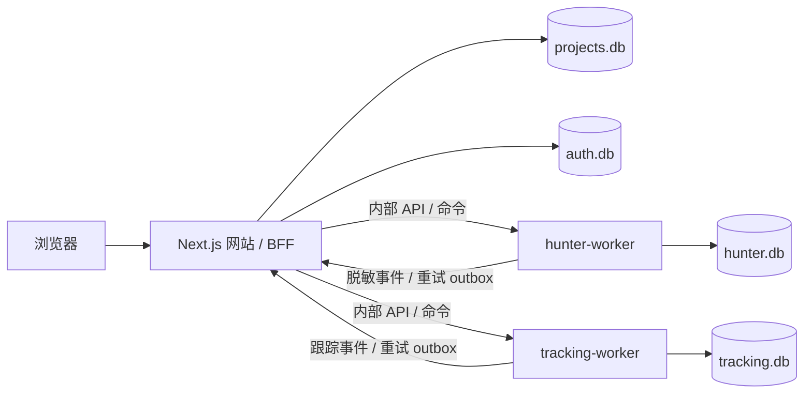

# 架构基线 v1 · 2026-10-15

## 范围与服务划分

从零建设；不继承旧版实现、ID、数据库、账号、队列或认证。单 Git 仓库、pnpm workspace、单台 Mac mini，网站与两个 worker 是三个独立 OS 进程，可独立启动/停止/升级。当前没有采集、告警、链上交互或 CRUD 业务。



箭头是目标契约；当前业务箭头未实现。网站持有项目主数据和认证存储，worker 是各自业务唯一写入者。不增加第四个服务、Redis、PostgreSQL、Docker 或消息代理；8GB 机器先保持资源可控。

## 工程目录

```text
apps/website/                  Next.js App Router、页面、BFF
services/hunter-worker/         猎手运行入口与未来采集器
services/tracking-worker/       跟踪运行入口与未来采集器
packages/contracts/            纯 DTO、ID、错误/事件类型
packages/runtime/              进程、HTTP、日志、存储基础设施
modules/projects/              项目领域保留位置（总管另行分配）
modules/auth/                  认证领域保留位置（总管另行分配）
schemas/{hunter,tracking,projects,auth}/  独立迁移归属
scripts/                       启动、验证、Git 检查、部署文件生成
docs/                          架构、接口、归属、交接、环境、部署
var/                           忽略的本 Worktree 开发数据
```

## 存储边界

| 逻辑领域 | 物理路径（DATA_ROOT 下） | 唯一写入者 | 计划业务内容 |
|---|---|---|---|
| Hunter | hunter/hunter.db | hunter-worker | 账号、观察、聚合、checkpoint、outbox、command inbox |
| Tracking | tracking/tracking.db | tracking-worker | 跟踪订阅、观察、checkpoint、outbox、command inbox |
| Projects | projects/projects.db | 网站项目领域 | canonical 项目、revision、映射、事件 inbox、审计 |
| Auth | auth/auth.db | 网站认证领域 | 用户、租户、角色、邀请、session hash、审计 |

当前四库只有 `_store_identity` 和 `_schema_migrations`，没有业务表。每库独立 application_id、文件、WAL；WAL、foreign_keys、synchronous=FULL、busy_timeout=5000、文件 0600、新目录 0700。不允许软链接/硬链接别名，不接纳缺少本 v2 标记的已有 DB。目录由启动器解析为绝对路径。

禁止 ATTACH、跨库 JOIN、读 worker 数据库/WAL、共用一个 SQLite 文件、从旧库导入。数据库初始化不是跨进程权限沙箱；同一 macOS 用户可以访问文件。若要求操作系统级权限隔离，正式部署时使用不同低权限运行账号/ACL 与独立服务配置；本基线只建立逻辑所有权、物理文件隔离和私有 loopback API。

每库迁移编号独立递增，记录版本、名称、校验和（后续迁移器须补齐）；不在服务请求中运行新增业务迁移。新 schema 的 upgrade、校验、备份、旧版本兼容与恢复测试由领域窗口负责，总管协调顺序。

## 项目 ID 与数据传递

canonical ID 为 `prj_<UUID v4>`，由项目领域生成，全生命周期不变。禁止用推特用户名、URL、合约地址或第三方 ID 直接当项目 ID。其他 DB 只保存此引用，不建立跨库外键。链上资产键为 `(chain_id, contract_address)`，链上地址按链规则校验与归一；X 用户名可变，最终优先稳定平台 user_id。

未解析候选的 `project_id=null`，事件携带 source entity key、tenant_id 和最小候选信息。Projects 通过 `(tenant_id, source, source_entity_key)` 唯一映射，在同一 projects.db 事务中解析/创建 ID 并写入事件回执。worker 只在持久化回执后更新自己映射。重复事件返回同一 ID；冲突进入人工审阅，不擅自合并两个项目。

worker 事务：观察 + 本地 checkpoint + 脱敏 outbox 原子提交，再 HTTP 发送；网站事务：校验服务身份 + tenant 授权 + event_id/hash 去重 + 项目变更 + inbox receipt 原子提交后 ACK。不假设两个 DB 可原子提交。传递至少一次；接收方的业务效果幂等。worker 断网/网站停止时积压，不丢事件、不回退到直接写项目库。payload 对外是字段白名单，原始 Hunter 身份保留本库。

网站发送 worker 命令也持久化 projects outbox；worker inbox 先持久化命令再 ACK，状态 pending/running/succeeded/failed/unknown，租约及 checkpoint 支持重启恢复。没有业务完成证据不得把 ACK 当作任务完成。

## 认证与隔离

auth.db 是独立认证数据源；登录、密码、Session 尚未实现。公开业务 API 当前统一关闭，不通过伪造用户、共享管理员、空密码或 mock session 放行。目标：Argon2id、HttpOnly/Secure/SameSite session cookie、只存 session hash、登录限流、CSRF/Origin 校验、不开放公开注册、超级管理员创建/禁用用户与重置密码、过期/撤销检查。

用户身份由 BFF 从认证存储验证。初始部署单站点 scope，tenant_id 由服务端固定配置，保留为未来隔离字段；不得由浏览器任意指定。所有查询先约束该 scope；仅 superadmin 和 user 两种角色：user 只读；所有项目修改、监控操作、猎手配置和用户管理只允许 superadmin。Hunter 配置不因普通项目读权限而可见。Cloudflare Access 可作为外围保护，不能替代应用权限。内部独立方向 token 只由服务器持有；网络认证不自动授予跨租户权力。

## 错误恢复与容量

启动失败返回非零；worker SIGTERM/SIGINT 停止接单、最多 10 秒 drain、关闭 DB。launchd 30 秒节流重启。服务自身不会改 Watch 或启动外部调用。未来采集器必须记录 input freshness、连接状态、backlog、最后 checkpoint、重试次数。ready 只描述 DB；连接必须由来源心跳证明。

API 默认 5 秒（内部）/10 秒（外部）timeout；重试仅 timeout、网络断开、429、502/503/504，Retry-After 优先、指数退避 1→2→4→8→16→30 秒加抖动。5 次失败保留持久任务，进入延迟队列或 dead letter；校验、鉴权、版本冲突不自动重试。receipt 未知或付费调用 unknown 必须先 reconcile。DB 写锁忙只做有界重试，不重建/删除数据库。

初始 worker 外部并发上限 2，各钱包/链任务隔离；每服务一个驻留实例，不同时运行 dev 和 start 共用数据。网站不依赖 worker 才能启动；worker 不依赖网站才能保存本地观察。构建按服务串行；不同时跑三个 Next dev/build。资源值是起始预算，不是实测业务吞吐。
