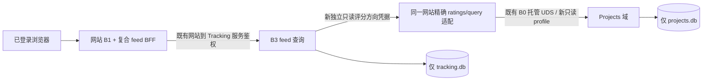

# C-02 / C-03 最小增量协议提案 v1

协议 ID：`projects-product-c02-c03-v1`。状态：`pending_protocol_review`；C-03 联合方案 `pending_owner_alignment`。产品推荐已批准，不能再标为待产品裁定；本文件不批准实现、正式收件或部署。

依据 Git 对象 `5c208ec74429c37a51f67f04558508e7f9b2538a` 的 `docs/product/{DECISIONS.md,DECISIONS-P0.md,decisions-v1.json}`。B2 已验收源码基线为 `d0fdefab2aa230ebb8df856aed306d0184d362e2`，验收记录来自 `ad4d5df91450a735465d21142ffc3e26536e948a`。B3 可复用范围只按已提交的 `2c7ce9a36350aa438c8d197b60d41de2b4aa1c96` 读取，不把其在途工作或旧工作日志中的产品未决状态视为本轮裁定。

本次提交只有协议、机器清单与静态核验记录。B2 的代码、SQL、旧报告、回执和测试产物保持原状。本提案需总管直接审查并同步 B3；B3 必须在其协议中确认同一方案/版本/文件哈希后，才可冻结 C-03 联合接口并实现。下文新接口均为提议，尚不存在。

## C-02：复用已验收的完成与恢复

语义 profile 仍为 `projects-home-v1`，不新增 CRUD、DTO 或数据库迁移。下面的项目路径均在 `/api/v1/projects` 下，`{id}` 是稳定 `prj_<UUIDv4>`。所有业务写入仍由 B1 验证 superadmin、同源/CSRF；user 只读。UUID `Idempotency-Key`、revision、原回执核对和错误沿用 B2。

| UI / 回调 | 精确现有调用 | 结果与边界 |
| --- | --- | --- |
| 表格“移除”→确认“标记完成并移除”；批量“移除已选” / `onArchive` | `POST /completions?view=home-v1`，body=`{"items":[{"project_id":"prj_…","revision":1}]}` | 1–100 项全成或全回滚；同时 completed + removed，保存修改前真实阶段/百分比。批量每项 revision，缺失428、陈旧409；不要求批量 HTTP If-Match |
| 单个完成入口（其他获批消费者可复用） | `POST /{id}/completion?view=home-v1`，body=`{}`，`If-Match: "rev-N"` | 同一完成语义，不建第二套“归档”实现；已有完成快照不覆盖时间/原进度 |
| “恢复跟踪” / `onRestore` | `POST /{id}/restore?view=home-v1`，body=`{}`，`If-Match` | 同 ID 恢复 persisted 快照，成员变 active；这里“跟踪”指主页研究集合，不启动 Tracking worker |
| 编辑器明确保存为完成 | `PATCH /{id}?view=home-v1`，body 含 `fields.progress_stage="completed"`、`complete=true`；可同时含 milestone，`If-Match` | 资料、事件、完成快照同一事务，不能先改 completed 再另做完成而丢快照 |
| 新建即完成 | `POST /api/v1/projects?view=home-v1` 的现有复合 body，`complete=true` 且阶段 completed | 沿用 creation_default：恢复 researching/null，不编造历史 |
| 明确的“仅从主页移除” / `onMembership(remove)` | `POST /{id}/home-membership?view=home-v1`，body=`{"action":"remove"}`，`If-Match` | 只改成员关系，保留研究进度，不生成完成快照；add 也不等于 restore |
| 详情“删除主页条目”→“确认移除主页” / `onDelete` | `DELETE /{id}?view=home-v1`，无 body，`If-Match` | 仍是 B2 仅成员移除，不能静默改成 completion，也不删 canonical/来源/监控引用 |
| Tracking 的停止/移除监控 | 沿用 B3 自己的命令 | 不调用 Projects completion/membership/delete；主页完成/恢复也不暗发 Tracking stop/start |

源码映射：`integration/website/components/projects-home.tsx` 的 onArchive/onRestore/onMembership/onDelete；事务复用 `candidate/projects_service/{service.py,home.py}`。资料读仍可用 `?view=home-v1` 取得 project/milestone/completion，completion/restore 返回已有复合投影。单项 If-Match 缺失428、格式错误422、过期409；同 key 同请求重放、异请求409。结果 unknown 只查原 method/path/contract/key 回执，不能盲重发。普通成员移除和详情删除文案应始终说明“仅主页”，不能将该按钮误标为“完成”。

DEC-C02 实际 app 接线由获批集成 owner 核对；当前 Projects 候选已有上述映射，本轮不改正式 app/UI。

## C-03：选定精确只读适配，沿用 B2 私有 IPC

本提案只采用下列方案，不同时实现“worker 通用 Projects 查询”或评分副本库：



不新增服务、端口、总线、后台同步或采集。B3 不取得 UDS token/socket，不直接读 projects.db；网站适配也不读 tracking.db。B3 只在处理本地复合 feed 查询时取得最小评分投影，在请求内/受版本约束的内存缓存中使用，不写成 Tracking 权威评分。备注只取 Tracking 本库订阅的真实 notes，评分只取 Projects。

### 1. 可信服务权限与精确路径

提议 `POST /internal/v1/projects/ratings/query`，JSON UTF-8，不接受 query 参数。版本在必填 body `profile="projects-rating-read-v1"`；POST 只为有界批量查询，不修改持久状态，不要求 Idempotency-Key/If-Match。其他方法405；不支持的 profile/未知字段422。不改变旧 `/api/v1/projects`、`/latest`、`/activities` 或旧 DTO 默认语义。

- 网站配置独立 32 随机字节以上的方向 secret（64 位十六进制）：`PROJECTS_RATING_READ_TRACKING_TOKEN`；B3 用自有0600 token文件读取对应值。不能复用网站→Tracking、Hunter/Tracking ingest、B2 IPC、Auth cookie、第三方 key。清单/日志/浏览器中不出现实际值；本轮不生成凭据。
- B3 的目标是受控配置里的既有网站 loopback origin + 上述精确路径，不能从项目官网、query或客户端header构造 URL，不跟随重定向；没有新的监听服务。正式入口的网络暴露策略仍由集成 owner 审查，逻辑 bearer 权限不冒充 OS 沙箱。
- 仅该精确路径/方法允许此 bearer，恒定时间比对，服务身份从网站受控配置派生为 `tracking-worker`、scope=`ikun-main`、capability=`projects.rating.read`。不接收调用者自报 principal/actor/role/tenant/capability；同名 body/header 不能增加权限。scope override 拒绝403；非法 ID/未知字段422。无配置503，缺失/错误 token401。
- 人类 cookie 单独调用401；伪造 X-Role/X-User-ID 不授权；user/superadmin 角色不变，没有第三个人类角色。B3 只读 token 对 create/patch/delete/ingest/command/通用 RPC 均无权限。内部 route 不发布 CORS，不把 token 放 NEXT_PUBLIC、URL 或公共响应。
- 网站 Proxy 可为该精确内部路径跳过**人类**登录转跳，但 handler 自身必须独立执行上述机器鉴权；不能扩大成 `/internal/v1/projects/*` 通配放行。公共 feed BFF/页面仍每次执行同一个 B1 用户 guard，退出/禁用/改密/过期不能靠内部 token 继续读。直接绕过 Proxy 同样有效。
- 私有 UDS 路径仍为 `POST /v1/rpc`，原 B0 方向凭据、0600 socket/0700目录、build SHA/入口 hash 均保留。仅新 contract 用独立严格模型 `RatingReadRpcV1`：`operation="ratings_query"`、`contract="projects-rating-read-v1"`、request_id、固定 service identity、query body；principal/actor/写入字段禁止。service 精确为 `{id:"tracking-worker",tenant_id:"ikun-main",capability:"projects.rating.read",credential_epoch:<64位hex>}`；epoch由网站用新只读secret的SHA256派生，仅用于可信传输与token绑定，不能由外部body决定、不能记录secret。旧 Rpc/ProjectRecordV2 不增加必填字段。域端再次检查 service/capability/scope/operation，不用伪造 user_id 绕过 B2 身份模型。

新私有 RPC 精确键为 `operation, contract, request_id, service, body`；`body` 只有 `project_ids, snapshot`，由 HTTP profile 映射到 contract；不接收 query/target/source/principal/if_match/idempotency_key。版本/字段错误422，凭据或能力未授权拒绝，不回退旧 Rpc 解析器。

### 2. 请求、响应与缺值

lookup body 精确键：

```json
{"profile":"projects-rating-read-v1","project_ids":["prj_550e8400-e29b-41d4-a716-446655440000"],"snapshot":null}
```

`project_ids` 为0–100个不同、完整合法的 canonical ID；重复/非法/超过100整批422。`snapshot` 必填，首页 null；后续批量/校验传首次得到的 opaque token（非空、最长2048）。空 ID 数组是只读获取/校验版本，不是查全部项目；不支持按评分枚举全项目，B3 只能投影自己当前完整查询涉及的 ID。省略/空串/损坏 token 不能冒充首页。请求实际 body 上限16KiB，响应上限64KiB。

成功 envelope 示例（所有数值和 ID 仅示意）：

```json
{"data":{"profile":"projects-rating-read-v1","snapshot":"opaque-signed-version","expires_at":"2026-10-16T00:05:00Z","items":[{"project_id":"prj_550e8400-e29b-41d4-a716-446655440000","state":"found","rating":"A","project_revision":3}]},"request_id":"c03_example"}
```

items 与输入同序、一一对应；空数组返回空 items。字段严格白名单：

| 字段 | 类型 / 含义 |
| --- | --- |
| project_id | 请求的稳定 canonical ID，不按 handle/名称推断 |
| state | `found` / `not_found`；跨 scope 与真实不存在统一 not_found |
| rating | found 时完整保留 S/A/B/C/D/null；DB 的 unrated 映射 null；not_found 时 null |
| project_revision | found 时当前正整数 revision；not_found 时 null。不同项目 revision 不能当全局评分版本 |

`found + null` 是未评分，`not_found + null` 是项目资料不存在；两者必须区分。主页 hidden/removed/completed 不改变已有 canonical 的 rating 可读性，不把“主页不显示”当缺失，也不降级/清空评分。无备注、名称、官网、来源映射、原始事件、配置或 credential 字段。

复合 feed **新投影**建议为 `{activity, subscription_note, project_rating}`；旧 TrackingActivity/Subscription DTO 不加必填字段：

- `activity` 沿用 B3 经 C-01/C-05 审查的稳定活动投影；generation 不重新制造公开活动。
- `subscription_note={state:"found", notes:<真实字符串>, revision:<订阅revision>}`；合法空串就是空备注。关联确实不存在时 `{state:"not_found",notes:null,revision:null}`。名称/handle/Projects.notes 均不能替代 notes。
- `project_rating` 为上述四字段评分投影。all 中显示 C/D、未评分或缺失的真实状态；S/A/B 筛选只匹配 found 的对应值。不给 C/D/null 编造 S/A/B。
- Projects 超时/失败时本 profile **整个查询失败**，不把故障伪装成 null、空 items、total=0 或陈旧成功。旧非复合查询保持旧能力，不能将其标作 C-03 成功。语音完全不实现，也不据此决定缺备注/缺评分播报规则。

### 3. Projects 版本、缓存失效与一致读取

复用 projects.db 的 `project_changes.sequence`；不新增 Projects SQL 或迁移。启动随机 boot nonce + 当前 scope 的已提交最大 sequence（空库0）构成逻辑版本；HMAC 签名 token 绑定 profile/scope/服务身份/credential_epoch/boot/sequence/首次签发/到期时间。密钥仅服务端内存，重启、签名密钥或只读方向凭据轮换使旧 token 失效；token 不是访问凭据，不替代 bearer。时长300秒，后续批次不续期；运行期过期用单调时钟判断，UTC expires_at 仅展示，时钟回拨不能延寿。

每次 lookup 在同一个 Projects 读取事务里校验 token 对应版本并取全部所需行。首次 null 在该事务创建版本；后续 token 非当前/过期/重启后为409 `SNAPSHOT_STALE`。包括创建、评分编辑、完成/恢复/成员变动等现有 project_changes 增长均保守失效；重复幂等回放未改变项目则无需失效。不能只依赖进程内“写后通知”，漏掉另一路 ingest。DB恢复必须停止域进程后按既有运维门禁恢复，不能在活进程中替换库并保留旧 token。

评分缓存只允许 B3 内存中的 `(scope, profile, Projects snapshot, project_id)` 正/负值；每个新 feed 请求使用前和返回前都实际调用空数组校验该 snapshot，任何版本变化整体丢弃。不能只给缓存设置300秒TTL后跳过校验；不能用上次成功评分掩盖不可用。token失效/到期/重启/权限配置轮换即清空；无持久副本、无后台刷新。初版也可关闭内存缓存，协议行为相同。HTTP/公共复合结果一律 no-store。

### 4. B3 全量筛选、计数、分页的联合算法

联合候选入口：`GET /api/v1/tracking/feed?profile=tracking-feed-v1&rating=all|S|A|B&limit=1..100&cursor=...`，网站只读 B1 guard → B3 对应私有 feed 查询。limit 默认50；rating 缺省 all，空串/未知值422。**路径/profile及 B3 的其他允许过滤字段必须由 B3 在同一方案确认后冻结**，不能将本提案当旧 latest/activities 已改变。C-01 的时间回退/排序、C-05 折叠 ID、D1 类型和 D2 保留边界仍由 B3 自有协议精确定义，本文件不批准替代版本。

必须遵守以下执行顺序，不能先读一页再装饰/筛选：

1. B3 在自己 tracking.db 的一致读取事务中构造完整候选集：已批准的类型/保留期/跨代折叠、非评分过滤先完成；备注从同一 Tracking 读取快照取得。不把 project_name 当备注，不把缺失类型伪装原创。
2. 枚举该**完整**候选集的 DISTINCT project_id，按最多100分批查询 Projects，首批获得 snapshot，后续批次全部绑定同 token；无候选也用空数组获取版本。不得只查询已加载一页、前100/600条或 rating 已缓存的一部分。某批失败/版本变动整次失败，不返回部分总数。
3. 在服务器对完整折叠集逐行应用真实 rating 谓词，先算 `total`、`by_rating={S,A,B}` 和 `unrated_total`、`missing_project_total`，再取 keyset 对应页。by_rating 及缺值计数基于相同非评分过滤全集，total 是当前 rating 过滤后的条数；all 的 total 还包括 C/D/null/not_found。unrated_total只计found+null，missing_project_total只计not_found；均计活动条数而非项目数。计数不受 cursor 位置影响。评分可以在 Tracking 请求内存 map 参与扫描，不写回本库；可流式扫描，不把所有正文装入内存或发给浏览器。
4. 排序与并列键严格采用 B3 获批 C-01/C-05 的 `effective_at DESC + 稳定公开 activity_id` 规则/方向；Project rating 不改变时间排序。采用 limit+1 判定 next_cursor；实际项目集合任意大小都必须完整执行，资源/时间不足返回错误，不能截断后声称准确总数。不能依赖旧 latest 每页本地排序或用 offset 假装跨页稳定。
5. 页数据、notes、计数来自同一 Tracking 快照，评分来自同一 Projects token。返回前 B3 以自己的独立读取检查当前 `feed_epoch`，再校验 Projects token；任何变化409并清空本次结果。两域通过版本验证组合读取，不声称跨库事务。

B3 联合协议必须给出一个**已提交、单调、包含全部影响 feed 的变动**的本域 `feed_epoch`：新活动、正文补全、订阅备注、状态/关联、C-05 折叠结果以及 D2 清理/恢复/政策版本变化都要覆盖。可复用其现有变化序列，前提是这些路径都在同一事务递增；不能只看新 tweet 的最大 seq 或订阅 updated_at。具体存储/迁移由 B3 owner 在同版协议补齐，不由 Projects 代写。此项未对齐前，C-03 联合协议不得标 approved。

新 opaque/HMAC cursor 必须绑定 scope、公共 profile、政策/排序版本、规范化**全部**过滤（含 rating）、limit、排序/稳定并列键、Tracking feed_epoch、Projects token及期限。cursor 非空校验、损坏/错profile/换过滤/换limit为422；任一底层版本变化/到期为409 `SNAPSHOT_STALE`（retryable=false，显式从首页重读），不能静默换版本或回首页。新活动也可保守使页链失效，初版不引入持久多版本历史或永久快照。B3 应说明此策略在活跃信息流下会要求刷新，不承诺写入期间旧页链仍可继续。cursor不是身份或访问凭据，每页仍重验 B1 身份；不从浏览器X-Role/X-User-ID推导授权。

### 5. 错误、预算、取消

全部成功/失败使用现有 envelope、合法 request_id、X-Request-ID、no-store；缺失/非法请求 ID 由网站生成，向下游传播，错误不暴露 secret、路径、SQL 或其他租户记录。

| 情况 | 私有评分入口 / 复合 feed 行为 |
| --- | --- |
| 机器凭据错误、scope错误、请求字段错误 | 401 / 403 / 422，retryable=false；不会回退通用项目读/写接口 |
| 当前版本与请求 token 不同、过期、重启 | 409 SNAPSHOT_STALE，retryable=false；从首页重新取新版本 |
| Projects未配置/DB故障/网络失败 | 私有503 AUTH_NOT_CONFIGURED/DB_UNAVAILABLE；B3公共503 PROJECTS_RATING_UNAVAILABLE，retryable=true，不能成功降级为未知评分 |
| 单次评分查询超时 / 复合总预算耗尽 | 504 UPSTREAM_TIMEOUT，retryable=true，不返回部分 items/total |
| 查询并发超限 | 429 RATE_LIMITED，Retry-After:1，retryable=true |
| 公共用户未登录或已撤销 / 用户尝试写入 | 现有 B1 401 / 403；机器能力不能替代人类权限 |

只读评分适配同时最多2个在途请求，不新增 worker；B3复合查询同时最多2个，分批顺序执行。每次评分调用总截止1500ms（包含 UDS/读取），每个复合请求5000ms，网站外层最多10000ms；统一传递取消/剩余 deadline。内层已有较长 IPC/SQLite 超时不能延长外层截止；超时后停止后续批次、取消上游，事务释放必须有界。不自动重新发送整条 feed，也不轮询/付费重试；客户端显式重试纯读可用同 cursor，但 stale 必须重开。预算不能完成全集时应失败，不减少查询集或伪造总数。

## 实现边界、迁移与回滚

| owner | 已有可复用 / 审查后最小变化 |
| --- | --- |
| Projects | 复用 B2 迁移、canonical ID/评分/变化序列、B0 UDS、错误 envelope；新增独立只读 transport model/域查询和精确网站适配候选/Proxy准入。只在 modules/projects 自有目录实现，根正式 app/配置仍交集成 owner；不改旧 Rpc 默认、ProjectRecordV2、CRUD 或 schemas/projects |
| B3 | 复用 Tracking 实际 notes、订阅revision、服务鉴权、读取/分页基础；新 feed profile 的全量复合算法、feed_epoch/缓存/cursor和错误映射由其自有范围实现，不持有 Projects 写权；C-01/C-05/D1/D2依其同版协议落实 |
| 集成/认证既有 owner | 获批后精确接线公共只读路径与内部机器路径，B1 singleton/guard不换实现；配置新方向凭据的受保护来源。协议批准不自动授权正式收件 |

Projects无迁移、无数据复制/评分回填；版本升级仅显式选 profile。回滚为关闭新适配/停止选新 feed profile，丢弃进程内缓存/令牌，保留旧接口原语义。B3独立迁移/回滚由其协议审查，不能将评分库复制进Tracking。Hunter 7天或Tracking15天清理各自处理，Projects项目/评分/完成快照/inbox/outbox/回执不随之删除。无跨库恢复承诺。新协议不用 B2 的原空白库/回执冒充已实现验收。

## DEC-C02 / DEC-C03 最小回归映射（尚未执行）

| 编号 | 计划验证 | 基线复用 / 新增门槛 |
| --- | --- | --- |
| C02-01 | 每个完成/恢复/仅成员移除按钮→精确请求和文案；user拒写 | B2实际UI/Node/API测试复用，集成实际app另验；不重写CRUD |
| C02-02 | 完成前真实快照、creation_default、重复完成/恢复、幂等冲突/428/409、批量原子性与unknown原回执 | 复用 test_b2_home/domain/browser 中已有覆盖，新增接线差异才加测试 |
| C02-03 | 完成/恢复不停止/启动监控，Tracking移除不改Projects；Hunter/Tracking清理前后Projects一致 | 双方合成本库状态对照、SQL访问边界；不连接真实业务库 |
| C03-01 | read token精确权限、错方向/配置/跨scope/伪造role、Cookie单独、直接handler/UDS绕过、拒绝写操作 | 新实际入口+域授权测试；不以Mock通过代替真实guard |
| C03-02 | 单批0/1/100/101、重复/非法ID、完整字段、C/D/null/not_found/跨租户、主页removed评分保留 | 新Projects临时库测试；旧DTO严格兼容 |
| C03-03 | 超过100个distinct项目、超过2页；S/A/B在旧首屏之外；同时间并列、已折叠活动、真实备注空值 | B3全量服务端筛选/计数/排序oracle，非浏览器页内过滤 |
| C03-04 | 连续多批中改评分/创建/成员变化/重启；下一页换评分/limit/profile；正文/备注更新和清理影响feed_epoch | 同版snapshot一致或明确409；不得跨版本拼装或静默首页；完整cursor绑定 |
| C03-05 | 缓存正/负值、评分更正、项目新建、备注更改、凭据轮换、超时/DB锁/不可用/取消 | 缓存不得以TTL掩盖变化；失败不回空成功，不泄漏凭据；deadline与并发有界 |
| C03-06 | B1 user只读、退出/禁用/改密后公共feed被拒、notes不是name；旧latest/activities行为不变 | 实际Next入口/两尺寸真实浏览器，组合依赖失败单列，不冒充平台通过 |
| C03-07 | 四库前后对照、Projects无持久写入、Tracking不读Projects/认证DB、旧迁移/回执未改变 | 临时合成夹具+访问审计，各owner只直接操作自己的业务库；Auth仅经已批准B1组件 |

本轮仅文档和静态一致性核验，以上均为未来实施验收，不报告新增功能PASS。B2原162全量/37提交后/内嵌10 Node为历史已验收证据，不重新累加或重跑。后续完整build/浏览器只有确需且获批实现后，使用主仓库唯一 `scripts/with-heavy-lock.py`，整个预览生命周期持锁；禁止和B3/B4重负载并行。语音、真实平台/Watch/付费、正式收件、合并、push、部署均未放行。
